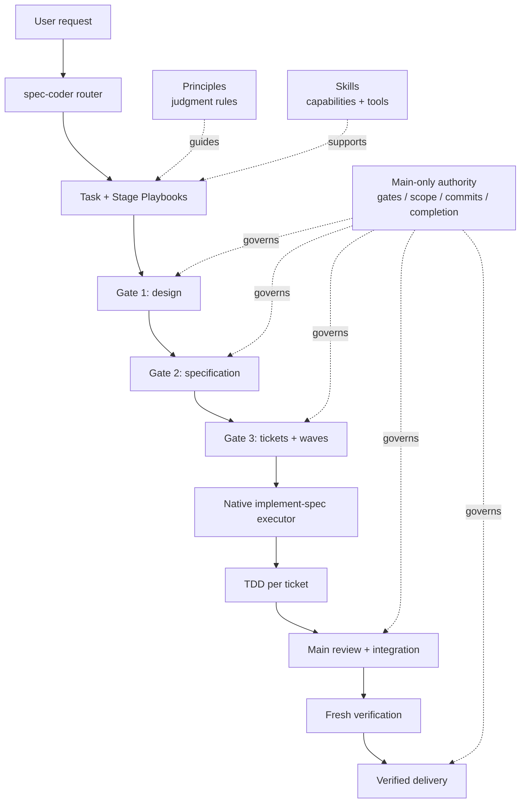

# spec-coder

`spec-coder` 是一组面向 Codex 的组合式工程技能：从需求澄清开始，经由轻量 DDD、Clean Architecture、规格和任务拆分，以 TDD 实现，并在完整审查与验证后交付。

当前版本为 `0.9.0`，插件包含九个 model-callable skills。

它参考 Matt Pocock skills 的“小而可组合”结构。插件负责阶段编排、审批门禁、产物位置和 Git 安全策略；`plan-coder` 使用本插件维护的模板完成规格合成与任务拆分，其余阶段组合允许模型调用的上游能力。

## Principles, Playbooks, Skills

The suite now separates three responsibilities. Principles supply triggered
judgment rules and limits; Task Playbooks own complete task SOPs; Stage
Playbooks compose reusable capabilities. Skills expose actions or thin
compatibility entries. Existing `design-coder`, `plan-coder`, and `tdd-coder`
names remain callable, while their procedures live in `playbooks/stages/`.

```text
Request -> spec-coder router -> one Task Playbook
                                  |
                                  v
                            current Stage SOP
                                  |
                                  v
                           capability Skills
                                  |
                                  v
                            tools / scripts
Principles guide judgment; Contracts own precise boundaries.
```

Hard boundaries constrain execution; design guidance requires contextual judgment.

## Architecture: request to verified delivery

The following diagram shows how a coding request moves through the three-layer
skill structure. `main` remains the authority for gates, scope, integration,
commits, and completion; child agents only execute bounded work or read-only
reviews.



Rendered PNG: [`spec-coder-architecture.png`](./assets/spec-coder-architecture.png)

ASCII fallback:

```text
User request
     |
     v
spec-coder router --> Task + Stage Playbooks
                           |
              +------------+------------+
              |                         |
       Principles guide          capability Skills
              |                         |
              +------------+------------+
                           v

Gate 1: design
    -> Gate 2: specification
        -> Gate 3: tickets + durable waves
            -> native implement-spec executor
                -> TDD per ticket
                    -> main review + integration
                        -> fresh verification -> delivery

Main-only: gates, scope, integration, commits, completion
Child agents: bounded execution or read-only review; no spawn
```

Read the selected task once, then only the current stage and triggered
Principles. A standalone stage reconstructs its supplied task handoff; it
does not select a different route. No new scheduler, generated instructions,
model dependency, or public micro-action skill is introduced.

| Observed trigger | Targeted principle |
| --- | --- |
| Bug Fix: Repeated repair failure | Attack the premise |
| Refactor: Reader load | Minimize reader load |
| Performance or Workflow Eval: Measurement | Explain the number |
| Design: Shared mutable state | Separate before serializing shared state |

## Skills

| Skill | 用途 |
| --- | --- |
| `spec-coder` | 总入口；识别新任务或恢复点，并编排完整流程 |
| `grill-coder` | 组合 `grilling` + `domain-modeling` 以保守 frontier rounds 澄清，并惰性记录已确认的领域语言或 ADR |
| `design-coder` | 保守分类并比较 2–3 个方案；bounded 任务合并为一次 Gate 1，架构任务保留两阶段设计评审 |
| `plan-coder` | 重新验证已准备的 workspace，再生成规格和垂直 tickets |
| `tdd-coder` | 对单个 ticket 执行 Red–Green、局部验证和原子提交 |
| `delivery-coder` | 对照规格审查、修复问题并运行完整验证 |
| `show-me` | 在每次 suite-owned human approval 前生成紧凑的 inline ASCII review map |
| `using-git-worktrees` | 在选定隔离路径后复用或创建安全的可选 Git worktree |
| `setup-coder` | 手动、幂等地检查并初始化目标仓库的 spec-coder 使用方式 |

## Install

供 Agent 执行的完整安装、验证与故障排查流程见 [`INSTALL.md`](./INSTALL.md)。

从已经 clone 的仓库安装：

```bash
./scripts/install-local.sh
```

等价的显式命令是：

```bash
codex plugin marketplace add /absolute/path/to/spec-coder
codex plugin add spec-coder@spec-coder
```

也可以通过 GitHub 仓库注册 marketplace 后安装：

```bash
codex plugin marketplace add zhufaris/spec-coder
codex plugin add spec-coder@spec-coder
```

私有仓库安装依赖当前环境已有访问该仓库的 Git 凭据。安装或升级后启动 fresh Codex session，再通过 `/skills` 检查九个 skill 是否出现。

## Dependencies

本仓库保持 wrapper 精简，因此运行时需要以下上游 skills：

- Matt Pocock：`grilling`、`domain-modeling`、`codebase-design`、`tdd`、`code-review`
- Superpowers：`verification-before-completion`
- Architecture：`clean-architecture`

必需依赖须在当前 Host catalog 中可见、允许模型调用且输入输出契约兼容；仅有磁盘文件或启用配置不够。`using-git-worktrees` 已随插件本地化，只在选定隔离路径后调用；原地执行不调用它。详情见 [`references/upstream-compatibility.md`](./references/upstream-compatibility.md)。

`design-coder` 原生负责意图映射、保守分类、方案比较和 Gate 路由，两种模式均不把
`brainstorming` 作为必需能力；用户仍可在 spec-coder 编排之外手动调用它。

`0.9.0` 不依赖手动专用的 `grill-with-docs`、`grill-me-with-doc`、`to-spec`、`to-tickets` 或 `implement-spec`。当前 Matt `implement-spec` 的 `disable-model-invocation: true` 表示它仅作为 provenance，不是 dependency；其他 manual-only skill 也不应被配置、改名包装或修改全局文件绕过。discovery 直接组合可调用的 `grilling` + `domain-modeling`，原生 `plan-coder` 使用本地模板，Gate 3 后由 native implement-spec executor 执行已批准的计划。

## Task Playbooks

每个新任务在现有 discovery/design 证据上由 `spec-coder` **内部**选择且只选择一个
Task Playbook：Feature、Bug Fix、Refactor、Performance、Skill Change、Workflow Eval 或
Generic。所选 Task SOP 编排阶段流程，并定义 entry/design evidence、Red 或 preservation pin 与
delivery proof；阶段 SOP 调用底层能力，不增加 public skill，也不会改变固定的五阶段顺序、Gate 1/2/3、native
implement-spec executor、两层 agent tree 或九个 model-callable skills。任务 SOP 位于 `playbooks/tasks/`，路由与交接
contract 见 [Task Playbook contract](./references/task-playbook-contract.md)。

Bug Fix 在原始复现路径上区分实际契约允许但缺少处理的状态，与上游产生的不合法状态；未知合法性查实际契约和状态证据，只有 restart-only 情形优先检查持久化状态。修复只覆盖已确认根因的已批准范围，并由原始公共路径与相邻行为共同证明。

这种 separation 参考 Cursor `pstack`（`cursor/plugins` commit
`1ba91fc25c0977741dd0e267849e6234b037ed0a`）的 MIT provenance；`pstack` **not a dependency**：不 vendor、不 invoke，不需要安装、配置或模型标识。它不改变现有 Host
compatibility、model routing 或 runtime behavior。

The targeted premise, measurement, reader-load, and shared-state principles are adapted from
Cursor `pstack` (`cursor/plugins` commit
`4dd1d05818d19792e7cd6e818f1667f95f7e1dbe`), without vendoring or invoking
the upstream skills.

## Default delegation

Gate 3 之后，每个 dependency-ready 且具备完整输入、边界明确且可逆的 scope、独立验证 seam，并且不携带 main-only 权限或凭据的 eligible ticket 都会 default delegation 给一个 direct subagent；单个 eligible ticket 也同样委派。显式的 request-wide opt-out、ticket-specific opt-out 或 review-specific opt-out 只在对应范围改为 main-local 执行，并禁止该范围内直接或间接 spawn。opt-out 只在当前请求的对话中生效，不写入仓库或用户配置。

在 Gate 3 前，`plan-coder` 会把 ticket 拆成显式的 durable planned wave，并将 membership/order 一并交 Gate 3 审批。每个 ticket 恰好属于一个 wave；同 wave 不存在依赖或冲突，且 main-local ticket 单独成 wave。每次 Gate 3 通过后，计划（singleton 也一样）都进入同一个 native implement-spec executor：main 每次只维护当前最早未完成的 dependency-aware active execution wave，并为每个 selected ticket 调度一个 `tdd-coder` lifecycle。live dispatch batch 可以因 Host capacity 缩小，parallel mutation 必须具备 real Host/task workspace isolation；没有真实隔离时通过 serialized direct workers 逐个执行；用户明确要求并行时，先按[并行请求规则](references/subagent-routing-contract.md#explicit-parallel-requests)检查可行性并尝试准备隔离，再决定是否回退，并说明具体阻碍。用户要求必须并行时，不擅自改为串行。每个 ticket 一个 worker 不限制同 wave 的 sibling workers 并行；main 的整合与提交仍串行。There is no implement-spec wrapper agent and no merger subagent; runtime must not pull later-wave tickets，也不得重新分组；Host handles 仍只保留在对话中，checkbox 与 commits 用于恢复。

Gate 3 之后若已批准的 scheduling input 发生变化，立即停止 resume：先把变更写入 durable plan、取得 renewed approval record，并立即运行 `check-artifacts.py --phase plan`；随后重新计算 active-result accounting 并完成 compatibility pass，才可继续执行。这是 reopened Gate 3 的同一审批记录更新，不引入 fourth Gate。本轮新增的 internal support-path mappings 仅覆盖 `tests/forward_contracts.py` 和 `tests/fixtures/scenarios.md`；其他未知路径一律 fail-closed。

所有 Gate 解释、scope 决策、Red 或结构证据、diff 接受、fresh integration verification、归属、stage、commit、delivery 汇总及 completion claim 都是 main-only。agent tree 固定为 at most two layers，only the active main agent 可以 spawn；每个 direct-child brief 都写明 `delegation_allowed = false`，child 不得直接、间接或借助其他 skill/workflow 再委派。

delivery 默认使用两个相互独立的 read-only direct reviewers：一个执行 Standards axis，一个执行 Spec axis。request-wide opt-out 或 review-specific opt-out 会让 main 在本地完成同样的两条 review；spawn unavailable 且 delegated review 未被明确要求时也如此。若 delegated review was explicitly required，则缺失 spawn 是 blocker。main 检查 reviewer evidence 并对最终结论负责。

### Worker Progress Heartbeat

当 Host 提供 proactive child-to-main messaging 时，每个 suite-owned direct
child（implementation worker、Standards reviewer、Spec reviewer，以及 main
创建的 promotion sibling）都要按共享 `ProgressSnapshot` 契约主动上报：开始
时、active 期间每 45-60 seconds、phase change、long command 前后，以及
blocker、failure 或 completion 时立即上报。它是 conversation 中的观测证据，
不是 Host 轮询、持久状态或授权机制；短任务只需要 starting 与 terminal
snapshot，不能伪造周期更新。

main 在 before or at dispatch 记录消息能力：可用时为 `heartbeat-ready`，不可用
时为 `heartbeat-capability-unavailable`；后者仍保留既有 delegation 和最终返回
流程，不承诺插件会实现 Host 消息功能。普通无消息观察是
`awaiting-heartbeat`；只有 missed interval 或 Host wait timeout 才记录为
`heartbeat-overdue`。两者都只描述该观察窗口，不表示 failure 或 blocker，也不
授予 interrupt、takeover、promotion 或 local fallback 权限。所有 snapshot 都
不能越过 main-only 的 diff acceptance、fresh verification 或 completion
authority；direct-child 的 `delegation_allowed = false`、不 stage/commit，及
reviewer read-only 边界保持不变。

每个 direct-child brief 携带由 routing schema 所有的一个 canonical ProgressSnapshot envelope；`observed_at` 使用 actual send-time，字段不使用 aliases。无效 snapshot 没有 execution authority，不能恢复、推进或改变既有 main-only 边界。

Heartbeat emitter：heartbeat-ready brief 必须携带 main 提供的绝对
`scripts/progress-snapshot.py` 命令。Worker 用 `python3` 加该绝对路径和七个
必需字段 flags 组成 argument vector 调用，并立即原样转发唯一一行 stdout；
手写 manual JSON 不是 primary path。Emitter 调用失败时，progress evidence
记录 `heartbeat-emitter-unavailable`，随后才使用 canonical manual envelope
作为 bounded fallback；该 fallback 不改变 delegation 或 main-only authority。

每次 suite-owned human approval 或 mutation review 都先由 `show-me` 展示 authoritative artifact、关键决定、风险、授权效果和下一阶段，并提供 two to four 个 grounded、实质不同且带后果说明的选项；`show-me` 只呈现，不代替用户选择或授予权限。

## Optional subagent model routing

`0.9.0` 为新建 subagent 提供三挡模型：`economy`、`standard`、`strong`。插件自带 trusted bundled defaults，因此 no initial configuration 也能使用 Luna/economy、Terra/standard、Sol/strong；实际委派仍以 live Host capability 为准。active main 始终使用 current Agent/session model，routing 不会切换它；Gate 解释、scope 变更、最终架构/安全决策、改动归属、commit、delivery 聚合和 completion claim 始终是 `main-only`。

完整 agent tree 固定为两层：第 1 层是 active main，第 2 层是它的 direct subagents；只有 active main 可以 spawn/delegate。每个 child brief 必须包含 `delegation_allowed = false`，子 agent 若需要进一步拆分或委派，必须把证据和 blocker 返回 main。main 可以创建新的第 2 层 sibling 完成一次 promotion，但 child 不能直接或间接创建替代者。Host 若支持禁用 child spawn tool，应作为 defense in depth 使用；这是契约约束，不代表 Host 层沙箱隔离，也不宣称跨 Host 的 sandbox enforcement。

以下可选 trusted user 配置位于 `$XDG_CONFIG_HOME/spec-coder/model-routing.toml`；未设置 `XDG_CONFIG_HOME` 时使用 `~/.config/spec-coder/model-routing.toml`。有效用户文件会完整替换 bundled defaults，不与其合并；无效用户文件会告警并选择 `inherit-main`，不会静默回退到 bundle：

```toml
version = 1

[tiers.economy]
provider = "trae"
model = "GPT-5.6-Luna"

[tiers.standard]
provider = "trae"
model = "GPT-5.6-Terra"

[tiers.strong]
provider = "trae"
model = "GPT-5.6-Sol"
```

每一挡都可省略；出现时必须同时提供非空的 `provider` 和 `model`。bundle 中固定使用上面的三组值；用户文件中的 provider/model 仍须在使用前对照 live Host catalog 和 subagent tool interface，并不构成必需模型依赖。

目标仓库只能在 `.spec-coder/model-routing.toml` 提高安全下限，不能指定模型：

```toml
version = 1
minimum_tier = "standard"
```

有效顺序是 `economy < standard < strong < inherit-main`。缺少 mapping、模型不可用或 Host 不支持安全 override 时向上查找，最终 `inherit-main`；无效用户配置或试图注入 provider/model 的仓库策略也保守地继承 main。一次真实 delegated attempt 失败、不确定、缺少证据或越界时，保留证据并直接提升到 inherited main，不再轮询其他配置档位。required model 不可用或低于安全下限时明确报告冲突，不静默替换。

`setup-coder` 可以发现并报告仓库策略，但不会创建或修改用户/仓库 routing 配置；任何用户拥有的配置写入都需要单独展示 exact diff 并取得明确授权。

`0.9.0` 的固定映射是 Luna/economy、Terra/standard、Sol/strong。已有配置仍由用户所有，不会被安装器或 workflow 自动重写；需要调整时由用户先审阅 exact diff 并明确授权。

## Default routing

在目标仓库中手动调用 `setup-coder`，它会默认检查并提议维护 repository-local `AGENTS.md`。权威模板为 [`assets/agents-snippet.md`](./assets/agents-snippet.md)；写入前展示精确 diff，重复运行应为零 diff。全局 `~/.codex/AGENTS.md` 只在用户明确要求 global scope 并单独批准 diff 时修改。只读解释、状态查询、调查和 review 不会自动进入此流程；使用 `skip spec-coder` 或 `directly modify` 可显式跳过。

## Validate

```bash
./scripts/validate.sh
```

验证包括仓库契约测试、九个 skill 的官方格式检查，以及 Git whitespace 检查。

## Baseline evidence and artifact checks

`0.9.0` 保持九个 skills；工具随插件的 `scripts/` 和
`scripts/spec_coder_checks/` 一起提供，依赖 Python 3.11+ 与 Git，无额外 Python 包。
各 stage 在 standalone/resume 入口加载必需的共享规则；main 每次 dispatch 都组装
[完整 worker brief](./references/worker-brief-template.md#assembly)。

Planning reuse interface 保持紧凑：同一 uninterrupted request 的 planning 对每条必需
记录运行 `check`，main 确认来源及依赖/环境仍有效后才复用，并报告 `record_id`。只有
standalone、resume、malformed 或 uncertain evidence，以及 rerun fallback，才加载完整
verification 细节；变更、缺失或未知输入都会要求重跑。resume、ticket integration 和最终
full verification 始终 fresh。
CLI exit 1 也可能表示 baseline 成功但记录不可复用，应分别检查 child `exit_code`
和 `reasons`。完整参数、声明限制与示例见 [Verification contract](./references/verification-contract.md)。

新[规格](./references/specification-template.md#copyable-v1-skeleton)与
[ticket 计划](./references/ticket-template.md#copyable-v1-skeleton)使用 v1 Markdown。
`check-artifacts.py` 在 Gate 2 前运行 `--phase spec`，Gate 3 前运行 `--phase plan`，
交付运行 `--phase delivery`，检查实际文件中的引用、coverage、dependencies、waves、
ownership 和记录字段。`--phase plan` and `--phase delivery` require an explicit target
`--repo`; `--phase spec` may omit it. 旧的无标记文档明确返回 unsupported，可在范围内规范格式或
人工 review，不能称为 checker pass。结构通过不证明业务正确性、命令实际执行或
批准；Markdown 仍是唯一权威。参数和 exit codes 见 [Artifact format](./references/artifact-format.md)。

## Workflow

这份流程面向在目标仓库中使用 `spec-coder` 的工程师：从一个新请求开始，知道每阶段需要什么输入、会留下什么产物，以及证据不足时返回哪里。恢复任务沿用已确认的路线，从实际证据支持的最早未完成阶段继续。

### 从请求到交付

新任务先检查仓库事实与 Host compatibility，选择且只选择一个 Task Playbook，并选择安全的 selected workspace。固定的五阶段随后执行：

```text
coding request -> one Task Playbook -> selected workspace
    -> grill-coder [read-only discovery]
        qualifying GLOSSARY/ADR write?
          yes -> workspace preparation -> resume grill-coder
          no  -> continue read-only
    -> design-coder [设计选择与 Gate 1]
    -> workspace preparation [若尚未完成]
    -> plan-coder
        specification + spec checker -> Gate 2
        vertical tickets + durable waves + plan checker -> Gate 3
    -> native implement-spec executor
        per-ticket tdd-coder lifecycle
        -> main acceptance + fresh integration checks + atomic commit
        -> next ready ticket in approved wave order
    -> delivery-coder
        Standards / Spec review -> repairs -> fresh full checks
        -> task-specific delivery proof + delivery artifact checker
    -> main final report [commits、验证结果、已接受的剩余风险]
```

workspace preparation 可以提前发生；它必须在首次符合条件的领域文档写入之前完成。如果 discovery 没有这类写入，则可在 Gate 1 后、规划落盘之前完成。选择 workspace 本身只支持只读调查与设计。

准备时实际检查并准备所需依赖，运行每条必需 baseline command，再用 `verification-evidence.py capture` 保留结果，分别检查执行退出码与记录的可复用性。失败或证据不确定时停止目标项目写入。`plan-coder` 在写规格前重新验证 workspace、改动归属与基线有效性；同一请求的 planning 仅按 verification contract 复用匹配记录，resume、ticket integration 和最终 full verification 都使用新验证。两条合法路径如下：

```text
grill-coder -- qualifying write --> workspace preparation
    -> resume grill-coder -> design-coder [Gate 1] -> plan-coder
grill-coder -- no discovery write --> design-coder [Gate 1]
    -> workspace preparation -> plan-coder
```

| 阶段 | 需要的输入 | 产物与完成条件 |
| --- | --- | --- |
| `grill-coder` | 请求、选定 workspace、实际仓库证据 | 确认需求、范围、领域含义与未解决问题；仅在必要且 workspace 已准备时写 `GLOSSARY.md` 或 ADR |
| `design-coder` | 已确认需求与现有实现边界 | 比较真实备选、推荐设计、风险和 testing seam；Gate 1 确认设计 |
| `plan-coder` | 已批准设计、prepared workspace 及有效基线证据 | 规格通过 `--phase spec` 后进入 Gate 2；垂直 tickets、ownership、dependencies、durable waves 通过 `--phase plan` 后进入 Gate 3 |
| `tdd-coder` | executor-issued 当前就绪 ticket、批准范围、实际 base 和完整 handoff | 原始行为 Red–Green 或适用的结构/行为保持证据、affected checks；main 检查整合结果并为完成 ticket 原子提交 |
| `delivery-coder` | 全部 ticket 完成、累计接受的范围及实际提交 | 两轴审查与必要修复、fresh full verification、所选任务的 delivery proof 和 `--phase delivery` 检查；main 才能声明交付 |

`grill-coder` 每轮只讨论 dependency-ready frontier：至多三个相互独立的问题，改变 scope、领域含义、ownership、核心 invariant 或 architecture 的问题，以及 coupling 重叠或未知的问题保持串行。每题保留稳定 `Qn`、选项和 recommendation/reason；多题轮次用 `Qn: default` 接受单题推荐，partial answer 只确认已明确回答的题。Repository facts 由 agent 查证。规范术语、上下文含义或 invariant 确认后才惰性维护领域语言；ADR 只记录难以逆转、脱离上下文会令人意外且有真实取舍的决定。

`design-coder` 仅在证据同时支持 existing implementation seam、one coherent outcome，并排除新 subsystem、public-interface shape、cross-context consistency rule 和 unresolved load-bearing architecture 时分类为 bounded。未知情况按 architectural 处理。bounded interactive 路径将备选、推荐短设计、风险与验证 seam 合并到一次 Gate 1；选择非推荐项返回 elaboration 后再次请求 Gate 1。architectural 路径先选择方案，再细化并进行 Gate 1。

DDD 与 Clean Architecture 按实际复杂度展开：确认受影响的 Bounded Context、领域语言、状态所有权和必要模型，区分领域规则、应用编排及 adapter 转换。并发、重试或跨上下文协作须明确原子性、冲突结果、幂等与恢复责任。小任务不需要为了模型角色逐一创建类。规格保存这些决定，垂直 tickets 引用规则、接口和验证证据；Gate 2 检查信息保留，Gate 3 检查场景覆盖与实施条件。具体要求与实例见 [Domain Design Contract](./references/domain-design-contract.md) 和 [Domain Design Examples](./references/domain-design-examples.md)。

### 一条路线，不同的任务证明

Task Playbook 改变各阶段关注的证据与完成证明。路由按下表顺序采用第一条有证据支持的路线；证据缺失或冲突时使用 Generic，或停止处理未解决的关键人工决定，不组合多个任务 SOP。完整规则由 [Task Playbook contract](./references/task-playbook-contract.md#route-precedence-and-one-selection-rule) 维护。

| 路线 | 控制任务的事实 | 交付需要证明 |
| --- | --- | --- |
| Workflow Eval | 明确请求一次独立行为比较 | deterministic Green 后进行等条件匿名比较；无回归，无法下结论时保留 Parent |
| Skill Change | skill 指令、frontmatter 或行为本身是变更对象 | Host 可见性/调用资格与确定性契约通过，再完成必需的匿名行为比较 |
| Bug Fix | 已观察缺陷与匹配的复现入口 | 原始复现转绿，根因已修复且相邻行为保留 |
| Performance | 可重复测量的资源目标与可比基线 | 正确工作量下的测量结果达到事先确定的目标，证据支持真实收益 |
| Refactor | 已明确保持当前外部行为的结构改动 | 行为保持检查通过，并有结构简化或依赖关系的证据 |
| Feature | 有意新增用户可见行为、数据形态或接口能力 | 新场景与拒绝边界满足规格，相关行为验证通过 |
| Generic | 没有证据支持更具体路线的安全代码工作 | 批准的范围与对应验收得到实际证明 |

Skill Change 和 Workflow Eval 的匿名比较在 mandatory deterministic/artifact Green 后进行：输入与条件可比、材料经过清理，回答者使用工程问题，judge 只接收匿名回答与私有标准。main 阅读全部回答和可用 transcript 后决定是否接受。确定性失败或权限、审批、依赖、产物、上下文预算回归不能被评分覆盖；不确定或冲突的证据保留 Parent。小规模比较不能证明普遍收益。

### 交接、原则与执行

入口读取所选 Task SOP 一次，把当前步骤、proof obligations 与已观察的触发条件交给当前 stage。stage 只读取自己的 SOP 和已触发 Principles。完整 handoff 禁止重新读取 Task 文件；standalone/resume 缺少 handoff 时，用已批准产物及 `task-step.py` 恢复所选步骤；冲突的编排输入返回 router，不重新选路线。Principles 提供判断，Contracts 维护精确权限与格式，Skills 调用能力。

新增判断在相关节点生效：

| 情况 | 使用的判断 |
| --- | --- |
| Bug Fix 多次修复共用同一假设并失败 | [Attack the premise](./principles/attack-the-premise.md)：先观察能区分假设真假的证据，再决定下一次修复 |
| Performance / Workflow Eval 用数字作决定 | [Explain the number](./principles/explain-the-number.md)：先定阈值，记录次数、波动和实际瓶颈；排除错误、缓存/跳过工作及不等条件 |
| Refactor 难以追踪或存在隐藏/可变状态 | [Minimize reader load](./principles/minimize-reader-load.md)：减少读者需要记住的间接层和状态，保留有理由的行为与接口边界 |
| Design 中并发参与者写同一 mutable target | [Separate before serializing shared state](./principles/separate-before-serializing-shared-state.md)：独立事实可分别写入、读取组合；共同 invariant 保留结构化原子性或冲突控制 |

Bug Fix 在原始入口确定状态是否合法：合法状态缺少处理就在相应边界补处理；非法状态追溯最早的错误生产者或转换；未知合法性查实际契约与状态证据。restart-only 故障先查持久化 configuration、cache、lock 和 serialized state，不自动清理。历史状态恢复与当前创建资格分开，保留合法业务校验。只修复已确认根因及批准范围内的匹配故障，由原始公共路径与相邻行为验证，详见 [Bug Fix SOP](./playbooks/tasks/bug-fix.md)。

Gate 3 后，singleton 和多 ticket 都进入同一个 native implement-spec executor。按已批准 durable wave 顺序处理最早未完成的就绪 frontier；eligible ticket 默认交给 direct worker。真实并行修改需要实际隔离，不能把同 checkout 文件不重叠当成隔离。main 串行接受 diff、fresh integration verification、stage、commit 和 checkbox advancement；child 不得再委派或提交。委派、opt-out、显式并行请求及 heartbeat 的边界见前面的 Default delegation 和 [Execution Waves](./references/subagent-routing-contract.md#execution-waves)。

### 审批、恢复与权限

默认 Interactive Gate 由人工决定：Gate 1 批准设计，Gate 2 批准规格，Gate 3 批准 tickets、durable waves 与实施授权。每次 suite-owned human approval 或 mutation review 之前使用本地 `show-me` 呈现 ASCII review map 和 two to four 个有依据的选项；完整 artifact 或 exact diff 仍是决定依据。Gate 3 后已批准的实现、验证及原子提交无需第四次确认。

`autonomous=true` 只能由 current user request 明确启用，default is false，只在当前请求中生效，不从 repository/global config、`AGENTS.md`、历史会话或 subagent 推断或持久化。存在唯一 grounded recommendation 时自动选择设计与 Gate 1/2/3，跳过 human wait。Autonomous selection does not invoke `show-me`，记录 `auto-selected under explicit autonomous authority`。设计、规格、tickets、durable waves、self-check、TDD、审查、验证与提交仍要完成。无法确定唯一推荐或存在 unresolved load-bearing decision 时停止；明确 false 或撤销后恢复 interactive mode。

恢复时检查 authoritative workspace、实际 branch/base、初始用户改动、批准的规格、plan checkboxes、Git commits 及 fresh verification，重建最早未完成阶段和当前 wave，不沿用旧的成功结论或用私有状态文件替代计划。证据否定架构时返回设计；实现或检查失败返回当前 ticket；同一 blocker 连续出现三次时保留准确命令、输出与 resume point 后停止。Gate 3 后 scheduling inputs 改变时，执行 [Reopened Gate 3 scheduling barrier](./references/workflow-contract.md#reopened-gate-3-scheduling-barrier)，先更新计划与审批并验证产物，再恢复调度。

工作流不会自动 push、创建 PR、发布外部 issue、合并原始分支、安装或清理 worktree；scope expansion、named mutation、setup exact diff、配置、凭据、破坏性操作及其他 external effects 都需要 separate authorization。自主模式不扩大权限。完整边界由 [Workflow Contract](./references/workflow-contract.md) 维护。

构建与临时文件边界：每个分支的 source worktree 使用 `<repo>/.worktrees/<branch>`，构建缓存使用 `<repo>/.cache/<branch>/target`。`/tmp` 仅用于 disposable small files，不得存放 source worktree、build cache、workflow artifact、verification evidence 或 recovery state。
